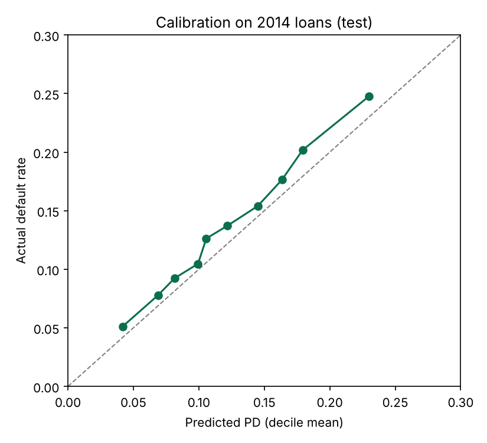
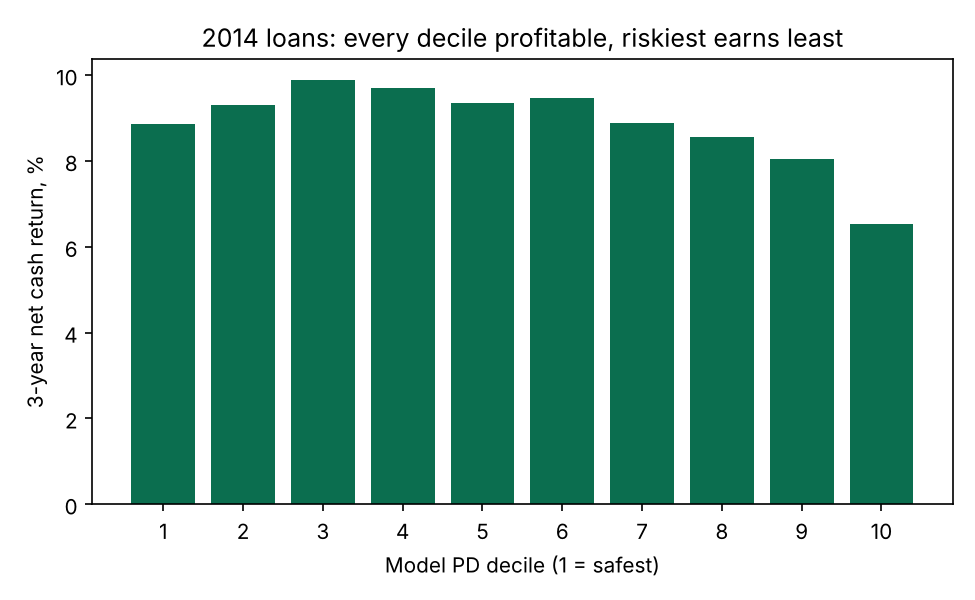
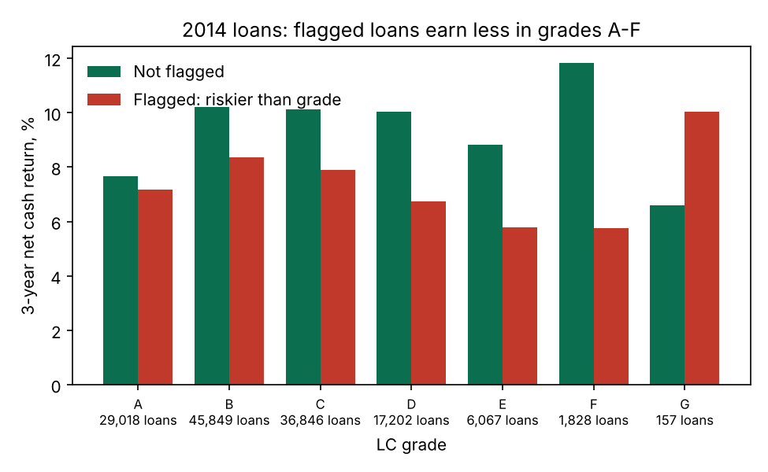
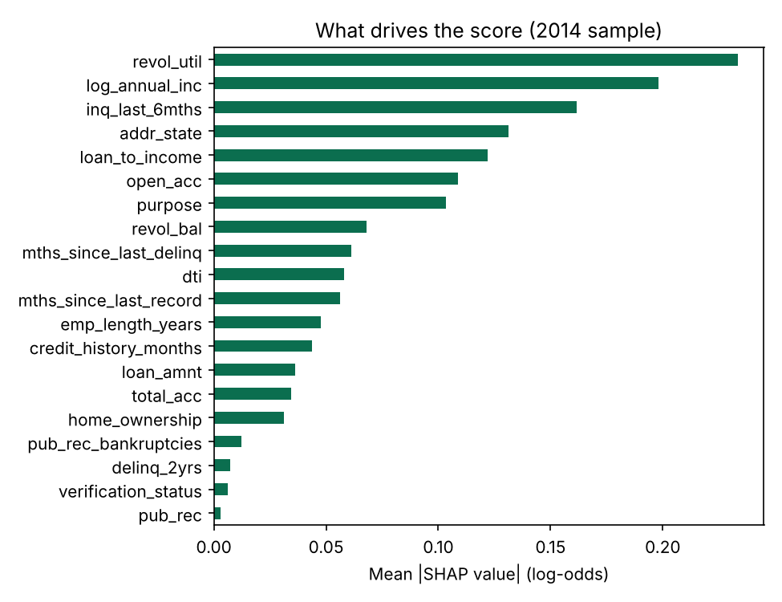

# Credit Risk on Real Lending Club Loans

Probability-of-default model for 36-month Lending Club loans, trained on 2007–2012 and tested on 136,967 loans issued in 2014 that the model never saw.

**Live demo: [credit-risk-lending-club.onrender.com](https://credit-risk-lending-club.onrender.com)** (free hosting, so the first load can take about a minute).

## Results at a glance

- **Ranking:** ROC-AUC **0.638** on 2014 loans using application data only. Lending Club's own sub-grade scores 0.658, because it uses the borrower's FICO score, which the public data leaves out. Adding the sub-grade to the model lifts it to **0.665**.
- **Calibration:** the model predicted a 12.4% default rate for 2014 and the actual rate was 13.7%. Ranking held up but defaults rose, so every decile came in 0.5–2.3 points above its prediction.
- **Decision:** a plain approve/decline cutoff added nothing. Lending Club charged riskier borrowers more, so every risk decile was still profitable. What the model does find is loans **priced too cheaply for their risk**. Within each grade, loans it flags returned **7.6%** over three years against **9.5%** for the rest.

## Data

[Lending Club](https://www.lendingclub.com) issued-loan files for 2007–2017, taken from the public mirror [kuhnrl30/LendingClubData](https://github.com/kuhnrl30/LendingClubData) (1.65 million loans). `scripts/get_data.py` downloads it.

Only **36-month loans issued up to October 2014** are kept, since by the November 2017 snapshot all of them had reached maturity and their outcome is known. That leaves 309,955 loans. *Default* means charged off or in default.

Three groups of columns are excluded on purpose:

| Excluded | Why |
|---|---|
| Payment history: `total_pymnt`, `recoveries`, `out_prncp`, `last_pymnt_d`, `last_credit_pull_d`, settlement and hardship fields | Recorded after the loan was issued. Using them leaks the outcome and gives a near-perfect but useless model. |
| Lending Club pricing: `grade`, `sub_grade`, `int_rate`, `installment` | Lending Club's existing risk score. Used as a **benchmark**, not as an input. |
| `emp_title`, `desc`, `zip_code` | Free text or too granular for this version. |

A unit test checks that none of these columns ever appears among the features.

**Data fix:** files from 2007–2008 record "no public record" as *0 months since last record*. That is impossible when the borrower has no record on file, so those zeros are treated as missing, matching later years. The same rule applies to delinquencies.

## Out-of-time validation

Loans are split by issue date, never at random, so the model is always tested on a later period than it learned from:

| Split | Issued | Loans | Default rate | Used for |
|---|---|---|---|---|
| Train | Jun 2007 – Dec 2012 | 72,566 | 12.6% | Fitting |
| Early stopping | Jan – Jun 2013 | 41,124 | 12.7% | Choosing the number of trees (267) |
| Calibration | Jul – Dec 2013 | 59,298 | 12.0% | Isotonic calibration and the flag cutoffs |
| **Test** | **Jan – Oct 2014** | **136,967** | **13.7%** | **Every number in this README** |

## Model comparison (2014 test set)

| Model | ROC-AUC [95% CI] | PR-AUC | KS |
|---|---|---|---|
| Logistic regression, application data | 0.634 [0.630–0.638] | 0.206 | 0.193 |
| **LightGBM, application data (shipped)** | **0.638 [0.634–0.642]** | **0.208** | **0.198** |
| Lending Club sub-grade alone (benchmark) | 0.658 [0.654–0.662] | 0.214 | 0.236 |
| LightGBM + Lending Club sub-grade | 0.665 [0.661–0.669] | 0.222 | 0.244 |

Confidence intervals come from 300 bootstrap resamples of the test set.

LightGBM beats logistic regression by only 0.004 AUC. Most of the signal here is close to linear, and the simple model would be a defensible choice for a regulated lender. LightGBM ships because it handles missing bureau fields and high-cardinality state codes without extra encoding.

## Calibration



Brier score is 0.115. The deciles fall in the right order, but all sit slightly above the diagonal. Defaults rose from 12.0% in late 2013 to 13.7% in 2014, and a model calibrated on 2013 can't anticipate that. In production this calls for monthly calibration monitoring, not a new model.

## The business decision

**1. A decline threshold doesn't pay.** The profit-maximising PD cutoff, chosen on late-2013 loans, was "approve everyone", and that held on 2014:



The riskiest tenth defaulted 4.8 times as often as the safest (24.8% vs 5.1%). It still returned 6.5% over three years, because those borrowers paid higher interest rates. These loans had already passed Lending Club's approval, so the model is ranking an approved, priced book.

**2. Flag loans that are riskier than their grade.** For each grade, the flag cutoff is that grade's 75th-percentile PD in late 2013. On 2014 loans:

| Group | Loans | Default rate | 3-year net cash return |
|---|---|---|---|
| All loans | 136,967 | 13.7% | 8.9% |
| Not flagged | 92,487 | 11.9% | **9.5%** |
| Flagged | 44,480 (32%) | 17.4% | **7.6%** |



Flagged loans returned less in grades A to F. Grade G is reversed, but it has only 157 loans. The cutoffs were designed to flag 25% of loans and flagged 32% in 2014, another sign that risk rose that year.

*Return* here is realised cash received minus amount funded, over the life of the loan, before servicing fees or funding costs.

## What drives the score



The strongest drivers are revolving utilisation, income, recent credit enquiries, state and loan-to-income. All point in the expected direction, which you can check in the demo's per-applicant SHAP chart.

## Stability

- Score PSI from training to test is **0.014**, well under the usual 0.1 alert level.
- Feature drift is largest for *months since last public record* (PSI 0.92). In 2014 Lending Club reported far more records, and more recent ones. The model still ranked well, but this is the first feature to watch.

## Limitations

- **No FICO score** in the public data. That is the main reason Lending Club's own grade beats an application-only model.
- **Approved loans only.** The data contains no declined applicants, so the model can rank approved borrowers but can't tell how a declined applicant would have behaved (reject inference).
- **Unresolved loans dropped.** About 2,200 loans that were still current or late at the snapshot are excluded. They lean risky, so default rates are slightly understated.
- **36-month loans only.** 60-month loans behave differently and need their own model.
- Returns ignore servicing fees, taxes and the cost of capital.

## Run it

```bash
pip install -r requirements.txt
python scripts/get_data.py            # about 230 MB parquet in data/
PYTHONPATH=src python -m credit_risk.train
pytest
streamlit run app/streamlit_app.py
```

Training takes about 90 seconds on a laptop. It writes `models/credit_scorer.joblib` (400 KB, committed so the demo can run), `reports/metrics.json` and the figures above.

```
src/credit_risk/
  data.py       loading, outcome definition, leakage-safe features, time splits
  model.py      scorer: LightGBM + isotonic calibration + per-grade flag cutoffs
  evaluate.py   KS, bootstrap CI, calibration table, PSI, policy outcomes
  train.py      trains, compares, calibrates and writes the report
app/streamlit_app.py   demo
tests/                  leakage, time-split and metric tests
```

## Version history

Version 1 of this repository used a 3,000-row synthetic dataset, scored ROC-AUC 1.00 and predicted loan *approval*, not default. It was replaced because a perfect score on rule-generated data proves nothing. The old notebook is still in the git history.
